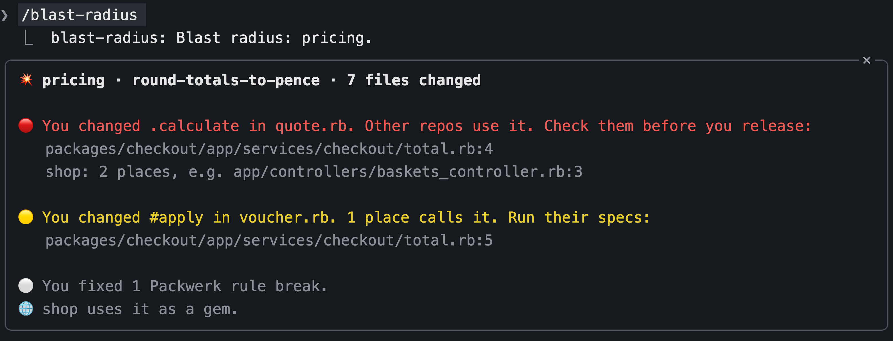

# blast-radius

A Claude Code plugin that shows what your branch can break, while Claude is still working on it.

[](https://github.com/ltarar/blast-radius/stargazers)



After each Claude turn, and whenever you run `/blast-radius`, it finds the code
that depends on the files your branch changes. It looks inside the repo, across
Packwerk package boundaries, and in your other repos that pull it in as a gem or
npm package. A pane beside the transcript lists each file that reaches outside,
with a traffic light and one line of advice.

| | Means |
| :- | :- |
| 🔴 | Used in other repos, or deleted while still used. Check before you release. |
| 🟡 | Used elsewhere in this repo. Run the specs for those lines. |
| 🟢 | Used only where it lives. Nothing to do. |

It also reads changes to `package_todo.yml`, so a new Packwerk rule break shows
up before review, not after.

## Install

1. Install the plugin:

   ```
   /plugin install blast-radius --marketplace ltarar/blast-radius
   ```

2. Tell it where your repos live. Run `/plugin configure blast-radius@blast-radius` and set
   **Repos folder** (only needed if repos aren't in `~/Repositories`).

3. Open the pane:

   ```
   /blast-radius
   ```

## Requirements

- Claude Code 2.1.294 or later
- `git` on your `PATH`
- Your repos cloned side by side in one folder

## Commands

| Command | What it does |
| :- | :- |
| `/blast-radius` | Opens the pane for the repos in focus |
| `/blast-radius <repo>...` | Adds repos to focus |
| `/blast-radius all` | Shows every repo with changes |
| `/blast-radius clear` | Clears focus back to the current repo |

A repo joins focus by itself when Claude edits a file in it. The status line carries a one-line summary.

## How it works

For each changed file, blast-radius compares the branch with its merge base on
`origin/HEAD`. In Ruby files it works out which methods changed and searches
for callers of just those. A change to comments only counts as safe. It skips
private files in Packwerk packages, since nothing outside can reach them, and
test files, which it counts instead.

To find other repos that use this one, it reads the gemspec or `package.json`
name and checks every repo's `Gemfile.lock` and `package.json` for it.

Everything runs locally with `git` and the files on disk. Nothing is sent
anywhere.
